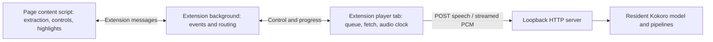

# Local Kokoro reader for Firefox

Draft for review — researched November 14, 2026. This is a proposed design, not an implemented server or extension.

Build a personal Firefox reader with a manually started Python backend, a compact player on the page, and local speech generation. Use HTTP streaming with an OpenAI-style speech endpoint. Start with selection and sentence-level highlighting; add article extraction and validated word timings next.

## Research: how providers stream audio

Transport, event framing, and audio encoding are different choices. HTTP, SSE, and WebSocket are standard mechanisms; a provider's JSON fields are an application contract. There is no single interchangeable TTS streaming protocol shared by all three providers.

| Provider / interface | Request and response | Relevance to our reader |
| --- | --- | --- |
| OpenAI Speech | `POST /v1/audio/speech` accepts text, model, voice, speed, and output format. Audio can be consumed incrementally from the HTTP response. Raw PCM is 24 kHz, signed 16-bit little-endian. | Closest fit for deterministic text-in/audio-out synthesis. |
| OpenAI Speech SSE | The reference also exposes `stream_format: "sse"` alongside the default `"audio"`; availability depends on model. | Structured events are an alternative when audio needs accompanying metadata. |
| Gemini TTS | Current Interactions documentation uses `stream: true`, with base64 audio in `step.delta` events whose delta type is `audio`. Its streaming default is headerless PCM, 24 kHz, mono, signed 16-bit little-endian; unary output is WAV. | Decode the event payload before playing samples. Older examples and model versions differ: don't infer streaming support from the Gemini name alone. |
| OpenRouter dedicated TTS | `POST /api/v1/audio/speech` uses the OpenAI-style request and returns audio bytes, not JSON. Its guide documents MP3 and PCM, and OpenAI SDK use with a changed base URL. | Confirms the speech endpoint is useful beyond one vendor. |
| OpenRouter audio chat | `POST /api/v1/chat/completions`, audio modalities, and `stream: true`; SSE carries `choices[0].delta.audio.data` plus optional transcript fragments. The example joins base64 fragments before decoding. | A different interface from dedicated TTS. Don't assume every event is an independently playable audio file or independently decodable base64 unit. |

Sources: [OpenAI speech guide](https://developers.openai.com/api/docs/guides/text-to-speech), [OpenAI speech reference](https://developers.openai.com/api/reference/resources/audio/subresources/speech/methods/create), [Gemini TTS](https://ai.google.dev/gemini-api/docs/speech-generation), [OpenRouter TTS](https://openrouter.ai/docs/guides/overview/multimodal/tts), [OpenRouter audio chat](https://openrouter.ai/docs/guides/overview/multimodal/audio).

OpenAI's current guide marks its existing speech models deprecated, with shutdown scheduled for January 6, 2027, and recommends its Realtime API for new hosted integrations. We are borrowing the speech request shape for a local service, not depending on those hosted models. Keep the client adapter isolated so this convention doesn't become a hard dependency. [OpenAI speech guide](https://developers.openai.com/api/docs/guides/text-to-speech)

OpenAI Realtime offers WebRTC and WebSocket connections; Gemini Live provides a conversational streaming interface. Those are worth considering for future microphone interaction, but introduce session/turn management that reading existing text doesn't need. We will not implement a conversational API simply to obtain streaming audio. [OpenAI Realtime](https://developers.openai.com/api/docs/guides/realtime), [Gemini Live](https://ai.google.dev/gemini-api/docs/live)

These are documentation findings, not paid API experiments. Google's speech URL redirected to its newer AI Studio documentation during research; use the linked current contract rather than mixing it with older Generate Content examples.

## Research: Speechify's relevant UI

Speechify's desktop help describes opening a floating player from the toolbar extension icon, then pressing Play to read from the top of the page. Its current Chrome product page shows sidebar and inline playback, voice choice, adjustable speed, and words highlighted in sync with audio. These establish the interaction direction, not a pixel-perfect specification. [Desktop instructions](https://speechify.com/blog/listen-to-a-webpage/), [Current Chrome interface](https://speechify.com/chrome/)

Research covered public first-party documentation and product-page illustrations, not an installed, authenticated Speechify session. The desktop help article dates to 2023; the current product page also promotes dictation, meetings, and AI assistance. We should borrow its reading controls without adding those unrelated features. Click-to-start at a word is described for its mobile apps in the help article; it is not treated here as verified desktop behavior.

Proposed UI for our extension:

| Surface | Behavior |
| --- | --- |
| Toolbar button | Reveal the player on the current page. If there is a selection, offer Read selection; otherwise offer Read article. |
| Context menu | Read selection directly. Later add Read from here for a paragraph. |
| Floating player | Small draggable panel, isolated styles, play/pause, previous/next sentence, Stop, voice selector, speed, progress, expand, minimize. Closing stops; minimizing continues. |
| Expanded reader | Clean text, sentence navigation, current sentence highlight, optional follow-along scrolling, connection status and settings. |
| Page highlighting | Highlight the current sentence in the original page when a reliable source mapping exists. Otherwise highlight only in the reader. |
| Word highlighting | Later enhancement using validated Kokoro token timings; gracefully fall back to sentence highlighting. |

Illustrative layout (our proposal):

```text
┌ Kokoro · Reading selection ──────────── _ × ┐
│ Previous   Play / Pause   Next       Stop  │
│ Voice: Heart ▾     Speed: 1.0× ▾           │
│ Sentence 4 of 28         Open reader      │
└───────────────────────────────────────────┘
```

Show Preparing, Buffering, Playing, Paused, Finished, and Server unavailable explicitly. Before synthesis, show progress by sentences; an exact total duration is unavailable until audio exists. A server error should preserve reading position and offer Retry. Keyboard controls must not intercept typing in page inputs.

## Proposed architecture



Use Manifest V3, but give playback a dedicated extension tab. The on-page player is a remote control for that tab. Open the player tab on the first session; require a visible Play gesture there if Firefox blocks automatic audio startup. Once activated, it can stay in the background while the user reads. Closing it stops playback. A sidebar may later expose the same controls, but should not own audio if closing the sidebar must preserve playback.

This tab is a deliberate initial UX tradeoff. Firefox MV3 background pages are nonpersistent, so don't rely on a toolbar popup or an always-running background script to own the audio session. A Firefox-only MV2 persistent background page is an alternative if eliminating the player tab becomes more important than MV3. Validate lifetime and autoplay behavior early. [Firefox background documentation](https://developer.mozilla.org/en-US/docs/Mozilla/Add-ons/WebExtensions/manifest.json/background)

Fetch from the extension player context with loopback host permission. Content scripts handle the DOM and send text/control messages; they never receive the server token or transport audio through page messages. Use `activeTab` and user-triggered injection rather than blanket access to all sites. [Content scripts](https://developer.mozilla.org/en-US/docs/Mozilla/Add-ons/WebExtensions/Content_scripts), [Host permissions](https://developer.mozilla.org/en-US/docs/Mozilla/Add-ons/WebExtensions/manifest.json/host_permissions)

## Server and wire contract

Proposed implementation: FastAPI/Uvicorn with one process, one resident `KModel`, and cached language pipelines and voice tensors. Keep server dependencies in an optional dependency group. Reuse the local-cache loading approach from `generate_tts.py`; do not spawn that script per request. CPU first; benchmark MPS separately before offering it.

Proposed startup: `python -m kokoro_server --host 127.0.0.1 --port 8880`. This command does not exist yet.

| Endpoint | Contract |
| --- | --- |
| `GET /health` | Readiness, model/device status, protocol version; distinguish loading from ready. |
| `GET /v1/voices` | Local extension: available cached voices and language codes. |
| `POST /v1/audio/speech` | OpenAI-style subset: `model`, `input`, `voice`, `speed`, `response_format`. Stream PCM or return a complete WAV. |

Example request:

```json
{
  "model": "kokoro",
  "input": "This is the next sentence to read.",
  "voice": "af_heart",
  "speed": 1.0,
  "response_format": "pcm"
}
```

PCM response: `Content-Type: application/octet-stream`, `Cache-Control: no-store`, documented format `pcm_s16le`, 24,000 Hz, mono. Include explicit sample-rate/channel/encoding headers for the custom client. Use normal HTTP response streaming; HTTP/1.1 transfer chunks and HTTP/2 data frames are transport details, not sentence boundaries. No JSON/base64 overhead on this path. A client using the OpenAI SDK must explicitly request PCM or WAV: MP3 and the rest of the hosted API are outside the first compatibility subset.

WAV mode buffers the bounded request's audio to write correct length headers and serves `audio/wav`. Do not concatenate complete WAV files into one response. Reject unsupported models, voices, formats, invalid speeds, and oversized input before streaming. Initial configurable limits: 4,096 input characters, speed 0.5–2.0, and a small bounded job queue. Start English-only (`a`/`b`) and advertise that scope.

Run synchronous inference in a dedicated worker, not the HTTP event loop. Serialize model use initially. Stop queued work on disconnect; an in-progress PyTorch forward pass may finish before cancellation takes effect. Drop its obsolete result and do not synthesize later chunks. Report overload with a retryable error. Once response bytes have started, failures terminate the stream; the client treats interrupted output as incomplete, never as a completed sentence.

Bind to loopback, require a token configured in extension settings, and validate Host/Origin where applicable. Don't enable arbitrary website CORS. Store the token in extension storage, not in a content script or page DOM. Log timings and errors without logging page text by default. These are small local-service controls, not a remote deployment design.

### Optional timing transport

Plain PCM carries no word timings. After the audio-only version works, add a separate local `POST /v1/reader/stream` endpoint returning standard `text/event-stream` with explicitly versioned **custom** events. This is not claimed to be OpenAI-compatible.

Proposed events: `start` (format), `segment` (text offsets and optional token timings), `audio` (sequence number, sample offset, independently base64-encoded PCM payload), `done` (total samples), and `error`. Metadata for a segment precedes its audio. Use a streaming POST fetch and a tested SSE parser; native `EventSource` is not the right API for a JSON POST with an authorization header. Handle arbitrary byte splits, partial UTF-8, event boundaries, and EOF. SSE standardizes framing, not our event schema. [SSE framing](https://developer.mozilla.org/en-US/docs/Web/API/Server-sent_events/Using_server-sent_events)

## Playback and actual streaming limits

The current pipeline calls model inference and then yields a completed audio tensor for a text chunk. It is not a model that yields individual audio samples while the same chunk is still being synthesized. Sending that tensor in small network packets cannot reduce time spent producing the first tensor. [Local pipeline](kokoro/pipeline.py), [Local model](kokoro/model.py)

The extension should split at sentence boundaries, preserve paragraph context in its document model, and request only the current sentence plus a bounded amount ahead. Start with one-sentence requests, combining tiny adjacent sentences only if listening tests show choppy prosody. A long sentence may still be split by Kokoro's phoneme limits. Tune from measurements rather than promising a particular first-audio latency.

Read `response.body` incrementally. Preserve a trailing odd byte between reads, decode little-endian int16 samples, and schedule AudioBuffers on the Web Audio clock at 24 kHz. Browser resampling handles the device's output rate. Don't call `decodeAudioData()` on arbitrary PCM/network fragments: it expects complete audio-file data. Use a small startup buffer and schedule adjacent buffers without timer-based gaps. [Web Audio decoding](https://developer.mozilla.org/en-US/docs/Web/API/BaseAudioContext/decodeAudioData)

Maintain one global reading session with a monotonically increasing session ID. Every queued request and playback callback belongs to that ID. Stop, seek, voice changes, or a new reading request invalidate old work and abort its fetches. Pause suspends playback and caps further generation. Bound buffered samples and retained history, initially targeting roughly 15–30 seconds ahead with an absolute memory cap; allow one bounded sentence to exceed the time target. Report underruns visibly and resume when buffered.

Use Kokoro's synthesis speed initially, with browser playback rate fixed at 1. Changing speed restarts the current sentence and clears prefetched audio; label this behavior. Instant pitch-preserving playback-rate changes can be explored separately. Avoid silently multiplying synthesis speed by player speed.

## Extraction and highlighting

Selection-first provides exact source ranges. For articles, evaluate bundled Mozilla Readability on a cloned document; it modifies the document it parses. Keep extracted text separate from the live page, and render text safely. [Mozilla Readability](https://github.com/mozilla/readability)

Represent a reading document as ordered blocks and sentences with stable IDs, original text, normalized spoken text, and source-offset mappings. Article cleanup breaks naive character offsets: retain a mapping during extraction, or conservatively match blocks back to live text. On ambiguous matches, disable original-page highlighting and use the reader view. Exclude navigation, controls, hidden content, and editable fields. If article detection fails, offer selection rather than reading the entire DOM indiscriminately.

Normalize offsets to a documented convention at the server boundary: Python code-point indexes differ from JavaScript UTF-16 indexes. Test emoji, repeated phrases, whitespace normalization, punctuation, abbreviations, and numbers. Use DOM ranges/highlight overlays without wrapping every word. If the page mutates and ranges become stale, clear highlights rather than pointing to unrelated text.

Kokoro's English path already attaches `start_ts`/`end_ts` to tokens using predicted durations in `KPipeline.join_timestamps`. These are estimated timings, not independently measured forced alignment; the implementation even contains an offset TODO. Validate against audio, preserve chunk-relative offsets, and map tokens to source text before enabling word highlighting. Its `text_index` identifies an input segment, not an original-page character offset. Non-English paths do not provide equivalent token mappings. [Timestamp implementation](kokoro/pipeline.py)

Drive highlights from actual consumed/scheduled audio time, accounting for pauses and buffering, never from network arrival time. Start with sentence highlights; enable word highlights only for supported, well-mapped English output.

## Implementation sequence and acceptance checks

1. **Transport and playback spike.** Add a small server module and a minimal extension player page. Verify a warm model can supply PCM that Firefox plays incrementally. Measure startup time, first audio, synthesis/audio duration ratio, underruns, and cancellation latency on this machine. Test browser autoplay and player-tab lifetime before investing in the polished UI.
2. **Personal selection reader.** Add toolbar/context-menu entry, floating controls, settings, queueing, pause/resume/stop, and sentence navigation. Acceptance: selecting multiple paragraphs reads them once in order; stopping or replacing a request never leaks old audio; minimizing controls and switching tabs preserve playback.
3. **Article reading.** Add Readability, expanded text view, sentence mappings, source highlighting, and optional auto-scroll. Acceptance: manually inspect a news article, documentation page, and Wikipedia page; test a dynamic page, failed extraction, and restricted browser pages. Unsupported pages get an explanation and a paste-text fallback in the player.
4. **Timed reading.** Add the separate SSE endpoint and validate English token timing/mapping. Acceptance: timings are monotonic and within audio duration; no stale highlights after pause, seek, speed change, or cancellation; ambiguous tokens fall back gracefully.
5. **Daily-use polish.** Add bounded recent-audio caching, optional local resume position, keyboard shortcuts, and startup/load instructions. Recheck a long reading session for memory growth and recovery from server restart. Keep page-text persistence off unless explicitly enabled.

Proposed files: `kokoro_server/` for HTTP and inference ownership, `extension/` for manifest/player/content scripts and bundled assets, server tests for streaming and cancellation, and extension tests for stream parsing, queues, and source mappings. Preserve the existing `generate_tts.py` CLI.

Meaningful tests include odd-byte PCM boundaries, truncated/error responses, cancelled queued jobs, no model reload per request, stale-session rejection, buffer limits, Unicode offset mapping, and text extraction fixtures. Firefox manual checks cover user gestures, background-tab playback, popup/sidebar closure, source-tab navigation, and player-tab closure. No tests were run for this draft; implementation and provider interoperability remain to be validated.

## Scope and review decisions

Recommended defaults: HTTP PCM transport; English voices; local service started manually; one active reading session; MV3 player tab plus floating page controls; sentence highlighting first; optional custom SSE for word timings.

The main tradeoff to review is the persistent player tab. It gives playback an explicit lifetime but adds one tab. The other decision is whether word highlighting should be required for the first usable release; recommendation: ship sentence highlighting first and validate timings next.

Out of initial scope: microphone input, hosted providers, account systems, browser inference, PDF/OCR extraction, Google Docs-specific integration, cross-device sync, automatic server installation, and extension-store publication. Temporary Firefox loading is sufficient for development; daily-use installation instructions should document the signing/development-browser path when packaging is implemented.
